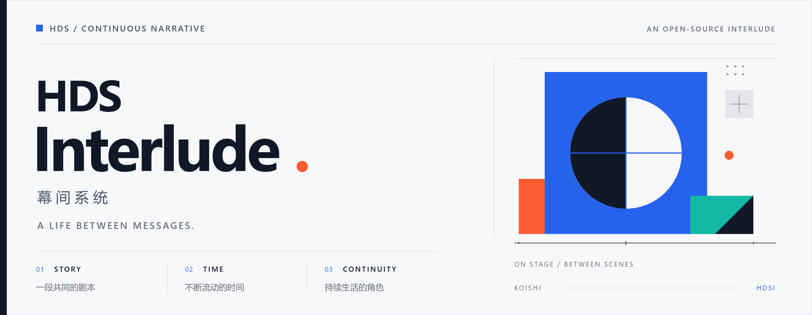
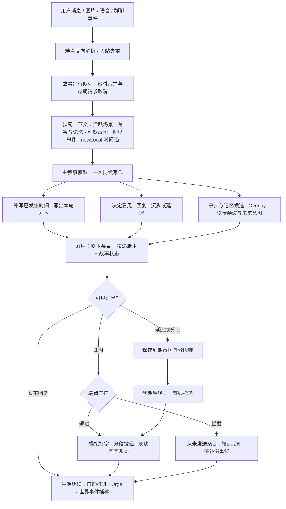

# HDS Interlude / 幕间系统



> 聊天在幕前发生，生活在幕间继续。

<p>
  <a href="https://gitee.com/MomoiCore/HDS-Interlude/releases"></a>
  <a href="https://koishi.chat/"></a>
  <a href="https://www.typescriptlang.org/"></a>
  <a href="LICENSE"></a>
</p>

**[快速开始](BEGINNER_GUIDE.md) · [一条龙向导](新人上手一条龙配置服务v1.0.1-rc52.html) · [下载发行版](https://gitee.com/MomoiCore/HDS-Interlude/releases) · [更新记录](docs/CHANGELOG.md)**

交流群：421430402，群主24小时解答，欢迎来玩！

HDS Interlude 是一个面向 Koishi 一对一与多参与者场景的持续叙事聊天框架。它让用户消息、角色的沉默、延迟回复、主动联系和自动推进，都成为同一段生活剧本中自然可见的部分，并由一次主叙事写作连贯地决定。

当前版本：`1.0.1-rc52`。

当前文档已同步至 2026-10-15 的 rc52，累计变更以 rc50 发布包为基线（含 rc50 后工作区未发布修复）。发布流程已执行源码构建，rc51 由本次生成的 `lib/` 与 `release/koishi-plugin-hds-interlude-1.0.1-rc52.tgz` 交付；旧 rc50 安装包不会自动获得这些修改，运行实例须安装并重载后才生效。

rc51 相对 rc50 汇总：端点在线状态启动竞态回查与 sweep 重同步、解析层主动行动丢弃留痕（关闭幻影发送缝隙）、冷却豁免用户回复、Agency 每日上限改为送达计数、历史图片过期链接缓存、停机/重载竞态中止、群受理人配置与 auto 意愿回退等 rc50 后续修复一并交付。详见 [更新记录](docs/CHANGELOG.md) 和 [投递与调度边界](docs/ARCHITECTURE.md#投递与调度边界2026-10-10-工作区更新)。

沿用 rc48 及此前能力：分享码同步会将 `storyDefaults` 同步写入配置模板；清库重建或新故事不会回退到旧人设；`interlude.preset.sync` 可强制重新应用预设；`database clear` 会重置同步状态；群音频可以直接触发携带原生音频的写作；跨会话投递能力继续保留。

历史兼容说明：rc12 起支持可选的 Anthropic Messages 自定义协议。该协议仍属于 `openai-compatible` 自定义连接，不是独立的官方 Provider 模式。详见 [rc12 适配说明](docs/development/ANTHROPIC_MESSAGES_RC12.md)、[更新记录](docs/CHANGELOG.md) 与 [文档索引](docs/README.md)。

## 文档导航

- 第一次安装和测试：[BEGINNER_GUIDE.md](BEGINNER_GUIDE.md)
- 从零部署 QQ 角色：[DEPLOYMENT_GUIDE.md](DEPLOYMENT_GUIDE.md)
- 逐项配置说明：[CONFIGURATION_GUIDE.md](CONFIGURATION_GUIDE.md)
- 管理员命令：[command.md](command.md)
- 当前架构：[docs/ARCHITECTURE.md](docs/ARCHITECTURE.md)
- QQ 合并转发读取设计：[docs/FORWARD_MESSAGE_READING_DESIGN.md](docs/FORWARD_MESSAGE_READING_DESIGN.md)
- 群聊历史图片证据回流：[docs/GROUP_HISTORICAL_IMAGE_CONTEXT_DESIGN.md](docs/GROUP_HISTORICAL_IMAGE_CONTEXT_DESIGN.md)
- Alter System 设计与运行规则：[docs/ALTER_SYSTEM.md](docs/ALTER_SYSTEM.md)
- Agency Window 设计与运行规则：[docs/AGENCY_WINDOW.md](docs/AGENCY_WINDOW.md)
- Schedule Preplan 近期日程层：[docs/SCHEDULE_PREPLAN.md](docs/SCHEDULE_PREPLAN.md)
- 版本记录：[docs/CHANGELOG.md](docs/CHANGELOG.md)
- 安全与依赖说明：[docs/SECURITY.md](docs/SECURITY.md)
- 历史分析、失败版本与调试资料：[docs/README.md](docs/README.md)

## 它解决什么问题

HDSI 以主角为中心维护持续剧情状态：角色拥有日程、关系、待办、情绪、配角和未完成事件；用户消息作为进入这段现实的一项事件，参与角色当下的判断与后续生活。

这套框架让角色从既有生活出发，自然决定何时看见消息、是否愿意回复、如何回应，以及这件事会给后续生活留下怎样的影响。

## 核心结构

### 一个主剧本，多位参与者

一个机器人账号维护一个 Canonical Story（主剧本）。多个已授权用户可以进入同一主剧本，但每位参与者保留独立的资料、初始关系、关系演化和近期互动状态。

这样，角色可以在不同账号之间安排注意力、兑现约定，或自然地表达自己正被其他事情占用；所有互动都汇入同一个稳定的人格与生活轨迹。

### 活跃场景是短期连续性的来源

每次主叙事写作都会读取当前活跃场景中最近发生的真实条目：用户 / 群聊事件、已成功投递的角色消息、剧本段落与必要的场景摘要。它保留原始对话的语义、说话顺序和时间信息，同时通过字符预算控制上下文规模。

当前用户事件在本轮以“当前事件”身份出现一次；自动推进则以纯粹的生活推进展开。这个边界让旧消息保持历史位置，也让尚未投递的角色台词始终停留在“未说出口”的状态。

### 固定阶段，连续生活

HDSI 不以时间间隔切换写作尺度，而是按当前事件进入四种明确阶段：用户消息、对话后续、到期意图与独立生活推进。每一轮都从故事游标补写已经经过的时间，并以当前 `nowLocal` 结束；调度间隔只决定何时唤醒写作，不会预设剧情的密度、情绪或篇幅。

这让同一段生活能自然容纳即时对话、被打断的输入、承诺到期、安静的对话余波和较长的自动推进。未来内容始终以意图、计划或延迟动作保存，已经送达的私聊则同时保留在剧本与结构化投递记录中。

每次主请求都会同时发送 UTC 与故事本地时间，并将 `nowLocal` 的日期、时分秒、星期、时段和日照预期作为权威端点。重载或长间隔后的 continuity 用于衔接上次状态，当前时钟则为新一轮剧情提供准确锚点；例如 `Asia/Shanghai` 的 16:00 会按仍有日光的下午处理。

## 一次消息如何变成剧情



```text
用户发送消息 / 图片 / 语音
        ↓
端点反向解析与入站去重 → 进入故事串行队列
        ↓
短时合并（多端点连续消息并入同一轮，旧请求作废）
        ↓
装配上下文：活跃场景、关系、记忆、到期意图、世界事件、nowLocal 时间锚
        ↓
主叙事模型一次写作：补写已发生时间 + 处理当前事件 + 决定可见行为 + 提取长期材料
        ↓
落库：剧本条目、投递账本 deliveryActions、故事状态与未来意图
        ↓
即时消息 → 端点门控 → 模拟打字与分段投递 → 成功回写账本
延迟或分段 → 保存到期意图，到期经同一管线投递
被拦截 → 记“从未发送”条目并进入端点冷却，待投递补偿稍后重试
        ↓
未回复时生活继续：自动推进、Urge 与世界事件播种驱动后续轮次
```

新消息遵循“首条回复提交”边界：主模型尚未提交第一条消息时，新输入会接管本轮，并与旧消息批次合并后重新写作；第一条已经提交后，新输入会截断尚未发送的 `<sep/>` 后续气泡。被截断的文字会作为“主角本来想发送，但还没打完字，新消息就到了”的未完成意图交给替代写作，清晰地区分已说出口的对话与被打断的念头。

## 主叙事模型的职责

主模型是核心写作者，在一次调用中完成“补写故事、判断是否回复、写出回复”等连续工作。每次调用会同时生成：

1. 当前时间段内已经发生的剧本；
2. 对当前用户事件、到期意图或自动推进的处理；
3. 是否已看见、回复模式、消息内容及计划发送时间；
4. 长期事实、状态变化、Overlay 候选、剧情余波和未来意图。

结构化输出中的互动决策形如：

```json
{
  "seen": true,
  "reply": {
    "mode": "immediate",
    "content": "怎么了"
  }
}
```

模型输出可使用 `<sep/>` 拆分消息。插件会按下一段文字长度模拟短暂输入时间；用户在等待期间继续发言时，旧分段计划会被取消并重新写作。

`typingJitterRatio` 默认是 `0.3`：同样长度的后续气泡会在理论延迟上下约 30% 随机浮动，减少机械感；填写 `0` 可恢复固定延迟。

### 实验性流式首条回复

`model.mainStreamingMode=experimental` 可让支持 OpenAI Chat Completions SSE 的模型在输出完整私聊 `interaction.reply` 后，先发送这条首泡，再继续接收后面的 `script`。默认关闭；它只在 `mainResponseFormat=json-object` 下生效，群聊仍等待完整结果。

| 支持层级 | 模型/接口 |
| --- | --- |
| 已有 SSE 接收路径 | `zhipu-official` 的 GLM 官方模型，例如 GLM-5.3-Flash。开启实验开关后可尝试首条提前投递。 |
| 实验性通用路径 | OpenAI 官方、DeepSeek 官方、Moonshot、百炼、硅基流动、OpenRouter、Gemini OpenAI 兼容模式，以及任意 `openai-compatible` 服务；前提是端点同时支持 `stream:true`、标准 `choices[].delta.content` 和 JSON 对象输出。 |
| 不适用 | `prompt-only`、不支持 SSE 的模型/中转站、只返回思维链但没有可见 `delta.content` 的接口。 |

未知中转站请先保持关闭；手动开启后观察日志中的“实验性流式首条回复已提前投递”。一旦首条已发送，若后续 JSON 断流或无效，插件保留已发送内容、记录 `stream-finalization-failed`，且不会自动 failover 重发第二条可见回复；后续只会以无 transport 的短恢复任务补写缺失剧本。

### 主叙事 payload 顺序与前缀缓存

`model.mainPayloadOrder=cache-first` 会把用户 payload 的对话历史与低频记忆层前置、每轮变化字段（当前事件、时钟、状态）后置。对支持自动前缀缓存的服务商（DeepSeek、GLM、Kimi 等），连续对话轮可以命中长长的稳定前缀，输入成本与 prefill 延迟显著下降；payload 末尾附带 `recentExchange` 最近交换块，把最后几条交互重新锚定在生成点旁，维持语境显著性。当前默认就是 `cache-first`；遇到服务商兼容性或上下文质量问题时可切回 `legacy`。开启后建议先在沙盒观察若干轮回复质量与 `回复模式` 分布。

自动推进不把 cache-first 当作世界时间来源：时间导演提供当前窗口内的推进建议，主叙事写出实际生活，宿主约束时间端点。beta6 不再把新计划自动当作完成事实；旧自动条目仍保留原账本解释。`recentExchange` 只含真实收发消息，不复制上一段剧本文字。实际是否复写仍需模型实机观察，不能仅凭缓存模式保证。

## 自动推进与剧情余波

对话结束后，系统可以按配置在约 10 分钟、20 分钟进行短期后续补写，之后按常规间隔继续生活推进；休息时间段可改用更长间隔。

自动推进没有实时用户消息，但仍会读取：

- 尚未结束的场景和近期已投递对话；
- 已安排的提醒、延迟回复、约定与未完成事项；
- 由对话留下的“剧情余波”；
- 角色自身正在进行的生活、配角和世界状态。

因此，用户说过的重要话、请求的提醒，以及影响角色的事件，都会在后续自动推进中持续留下线索。主模型可在角色具备具体动机时发起主动联系；每次候选动作都携带 `willingness`（意愿值）和原因，插件会在阈值、目标合法性与数量边界内完成投递。

Schedule Preplan 在后台空闲整理时维护近期稳定日程：每天最多复用压缩模型进行一次独立轻量审查，参考既有计划后才补写周规律、阶段或日期例外。`stable / contextual / granular` 变化颗粒度控制如何保留已证实的变化；granular 的少量候选安排先以半透明可用性显示，临近后才揭示，且不会自行成为生活事件。主叙事只读取从当前时刻起未来约 12 小时的计划，不会接收整周日历；计划只约束合理性，真实剧情始终优先。固定日程边界还可成为自动推进锚点，减少随机推进跨过上课、到校或离校等节点。

## 记忆与设定演化

HDSI 按用途分层组织信息，让每次请求获得恰当的连续性，同时保持上下文的清晰与节制。

| 层级 | 用途 |
| --- | --- |
| Canon | 初始角色、世界、配角与参与者关系，是剧情起点。 |
| 活跃场景 | 当前连续剧情的原始条目与摘要，是短期连贯性的主要依据。 |
| 剧情引子 / 近期事实 | 正在处理的事、最近生活细节、关系余波和下一步线索。 |
| 长期事实 | 承诺、重要事件、稳定世界事实和未解决事项。 |
| Overlay | 角色性格、世界状态、关系等在长期剧情中渐进形成的非破坏性变化。 |
| Perspective | 主角独立于 Canon 的个体价值观 / 看待世界的方式；其 overlay 只在相关情境中细微影响判断。 |
| 意图 | 延迟回复、提醒、主动联系或后续处理计划。 |
| Schedule Preplan | 近期计划中的生活结构；后台保存多日，主叙事只读取未来约半天。 |

较早的场景和 Overlay 会在后台分档压缩：保留因果、承诺、大事件与关系变化，减少重复性叙述。压缩以异步整理的方式运行，与用户回合的主叙事调用保持轻量协作。

近期上下文同时使用条目下限与时间窗口：默认至少保留 35 条，并保护最近 45 分钟的真实收发消息。长期事实检索分别为最近已完成事件和未完成承诺保留位置；承诺兑现后可显式关闭旧 fact，并促使 continuity 提前刷新。Continuity 不再保存容易过期的自由文本未来计划，未来安排由 intent 与 Schedule Preplan 提供。

### 修改设定时的建议

小幅修改 Canon（例如补充兴趣、修正措辞）通常可直接保留现有数据。若修改会明显改变角色身份、核心性格、世界规则或某位参与者的初始关系，建议在 Console 修改后按需清除对应 Overlay：

```text
interlude.overlay.clear character
interlude.overlay.clear perspective
interlude.overlay.clear relationship
interlude.overlay.clear world
```

指令会在聊天中要求 `y/n` 确认，并精确作用于选定的演化层，保留其余剧本与记忆。详见 [管理员指令集](command.md)。

## 主体行动窗口（Agency Window）

Agency 默认关闭（`agency.enabled=false`），需要时可显式开启；已有显式开启的配置不会被覆盖。关闭 Agency 不等同于关闭主动消息，后者仍由 `runtime.allowProactiveMessages` 等既有开关控制。

Agency Window 让主动联系先来自主角自己的生活，再经过现实条件判断。它沉淀当前日程负荷、隐私空间和设备可用性三类行动条件，并与 Alter 的情绪氛围层保持清晰分工。

自动生活回合完成剧本后，主模型可以提出一个由真实剧本、承诺、实际安排或关系后续支撑的联系候选：

```text
生活产生理由 → 检查日程/隐私/设备 → 立即联系 / 稍后重查 / 自然放下
```

忙碌或缺少隐私时，系统会创建 `proactive-check` 意图，在合适时间结合新的生活重新判断。每个候选都引用真实剧本条目，使主动联系始终拥有可追溯的生活理由。

Agency Window 复用 `StoryState` 和现有 intent 表，以轻量结构接入当前架构。后台获得参与者的名称、资料和关系摘要，并继续以摘要形式保持私聊上下文的边界。

## 情绪偏移追踪系统（Alter System）

Alter System 是一个动态氛围响应机制，用于解决长期对话中角色说话风格趋同、情绪表达固定化的问题。

### 工作原理

每次成功生成剧本时，主模型会输出一个整数 `alter`（-5 到 +5），表示本轮新事件相对上一轮让整体氛围发生的净变化：
- **正值**：对话氛围变得更严肃、正式、谨慎或紧张
- **负值**：对话氛围变得更轻松、随意、活跃或开玩笑

系统会累积这些 alter 值。当累积值超过动态阈值时，会调用侧端模型生成一段简短的"情绪偏移描述"（1-2 句话），并将其注入到后续主提示词中作为氛围参考。

这段描述会带有动态权重：
- **同向对话**：权重逐渐增加，氛围持续强化
- **反向对话**：权重逐渐减少，氛围自然消退
- **权重过低**：自动清除，避免过时的氛围影响新剧情

### 关键特性

- **低侵入性**：在原始剧本及来源化连续性资料旁加入临时氛围参考；beta6 已停用实时 continuitySnapshot 的重复生成
- **动态阈值**：根据对话密度自动调整触发频率，密集对话时更敏感，长间隔对话时更宽容
- **轻量级**：在达到触发条件时调用侧端模型，将额外请求集中在真正需要的节点
- **顺序协作**：达到阈值后先完成本轮持久化与消息投递，再在故事串行队列中执行侧端分析
- **自然衰减**：情绪偏移会随对话方向变化而自然消退，以临时氛围参考的方式陪伴剧情

### 配置参数

在 Console 的"情绪偏移追踪系统（Alter System）"配置项中可调整：

| 参数 | 默认值 | 说明 |
| --- | --- | --- |
| enabled | true | 启用 / 禁用系统 |
| baseThreshold | 10 | 基础触发阈值，值越小越敏感 |
| sameDirectionBoost | 0.05 | 同向增强系数，控制权重增长速度 |
| oppositeDecay | 0.15 | 反向衰减系数，控制权重消退速度 |
| minWeight | 0.2 | 最小权重阈值，低于此值自动清除 |
| maxIntensity | 2.0 | 最大强度上限，防止过度极端 |
| densityFactor | 0.3 | 对话密度影响因子，密集对话时降低阈值 |

侧端分析模型由模型中心中勾选“用作 Alter 侧端分析模型”的连接提供；温度、输出长度、超时和附加提示词在 Alter 设置内单独调整。侧模型遇到失败时，系统会保留累计轨迹并在后续条件合适时重试。

### 使用建议

- 默认配置适合大多数场景，不建议频繁调整
- 如果觉得角色情绪变化太慢，可以降低 `baseThreshold`（如改为 7-8）
- 如果觉得情绪变化太快或太极端，可以提高 `baseThreshold`（如改为 12-15）
- `sameDirectionBoost` 和 `oppositeDecay` 控制情绪的"惯性"和"恢复力"，建议保持默认比例

## OneBot / NapCat 与群聊

OneBot 模式采用显式白名单：启用后，绑定的机器人 QQ 账号和用户 QQ 白名单中的账号即可进入 HDSI。空白名单会保持私聊入口关闭，便于管理员从明确授权的参与者开始配置。

每位白名单用户可单独填写：

- 用户背景 / 角色眼中的身份；
- 初始关系；
- 是否参与共享主剧本；
- 需要时的独立备注。

群聊与私聊分开配置。群聊需要单独列入群白名单并填写群用途、主角在群中的身份和发言模式；符合白名单和调度条件的群聊消息直接进入主叙事模型，不再额外调用快速判断模型。群聊请求开始后，后续群消息会进入下一批，不会作废已经生成的群回复；私聊仍保留首条消息提交前的新消息替代写作机制。

对 `responseMode=always` 的活跃群，可按群开启纯算法 `willingness`：本地意愿分数会随消息、关键词和引用累积，按半衰期衰减，并在超过阈值后以概率决定是否值得调用主模型。@ 机器人可以立即通过（主角睡眠态除外：此时 @ 直通关闭且意愿按 20% 计），主角成功发言后会消耗意愿。这个层只减少不必要的群聊主模型调用，不参与私聊、Alter 或 Agency。

## 图片与网页观察

### 图片理解

开启 `vision.enabled` 后，可在 `vision.mode` 选择两种方式。`native` 适合支持图片输入的主叙事模型：图片作为 `image_url` 内容块和当前用户文本一起发送。`sidecar` 适合纯文本主模型：选择一条勾选 `useForVision` 的视觉连接，插件先生成当前图片的事实观察，再把该观察与用户文字交给主叙事。支持 OneBot CQ 图片码、URL、`file`、`cache_url` 与机器人 `get_image` 路径，兼容电脑端 JPG 和常见手机端图片来源。

动态 GIF、动态 WebP 与 APNG 可在 Puppeteer 可用时抽取代表帧后发送；安全读取条件不足时会跳过该图片。图片二进制与 sidecar 观察都保持在剧本、记忆与数据库之外；侧端识图失败时，插件继续处理当前文字而不猜测图片内容。QQ CDN 的过期图片链接会被进程内缓存并跳过重复回源，群上下文中保留 `[图片]` 文本占位。

### 原生音频理解

`model.audio.enabled` 是当前的语音路径：它不做文字转写，而是让 SnowLuma 将 QQ SILK 语音转码后作为原生音频输入交给支持音频的主模型（例如 Gemini）。可通过 `model.audio.outFormat`、`maxFileSizeMB` 和 `maxPerMessage` 限制转码格式、单文件大小和单条消息附件数。模型不支持音频、转码失败或超过限制时，插件保留“收到语音/音频”的事实并继续处理其它内容；未开启原生音频时，语音在上下文中以 `[语音]` 占位记录。

### 网页观察

可选 Puppeteer 服务允许角色在剧情确有需要时请求有限的网页观察。插件通过协议、页面数量、内容长度与超时边界，提取公开页面文本作为本轮写作参考；网页观察聚焦于安全、有限的公开信息读取。

## 安装

### 从 npm 安装

发布到 npm 后，可在 Koishi 项目根目录执行：

```bash
npm install koishi-plugin-hds-interlude@beta
# 或使用 corepack yarn（Koishi 官方推荐）：
corepack yarn add "koishi-plugin-hds-interlude@file:./koishi-plugin-hds-interlude-1.0.1-rc52.tgz" --exact
```

稳定版发布后可省略 `@beta`。然后在 Koishi Console 添加 `hds-interlude` 插件并完成配置。

### 本地 tgz 安装

rc52 安装包由本次发布流程生成；安装前请确认实际 tgz 路径，必要时核对同目录的 SHA-256 校验文件。使用本地预发布包时，Koishi Desktop 实例必须使用 Yarn 4 更新 package.json 与 yarn.lock；不要用 npm 安装：

```bash
node .yarn/releases/yarn-4.12.0.cjs add "koishi-plugin-hds-interlude@file:C:/absolute/path/to/koishi-plugin-hds-interlude-1.0.1-rc52.tgz" --exact
```

Windows 示例：

```powershell
node .yarn/releases/yarn-4.12.0.cjs add "koishi-plugin-hds-interlude@file:C:/dev/HDS-Interlude/plugins/hds-interlude/release/koishi-plugin-hds-interlude-1.0.1-rc52.tgz" --exact
```

Koishi Desktop 的实例使用 Yarn 4。请在实例目录执行以下命令，并在完成后重载插件或重启 Desktop：

```powershell
node .yarn/releases/yarn-4.12.0.cjs add "koishi-plugin-hds-interlude@file:C:/dev/HDS-Interlude/plugins/hds-interlude/release/koishi-plugin-hds-interlude-1.0.1-rc52.tgz" --exact
```

安装后重新加载 Koishi，再在 Console 启用插件。

### 开发实例

仓库根目录包含开发用 Koishi 实例。安装依赖后：

```bash
cd C:\dev\HDS-Interlude
npm install
npm run dev
```

OneBot / NapCat 未启动时可能出现 `ECONNREFUSED`，表示适配器正在等待本地反向 WebSocket；可通过构建与插件加载日志分别确认 HDSI 的编译和加载状态。

## Console 配置顺序

建议按以下顺序配置，以更快建立可验证的互动闭环：

1. **盲区模式（原“失明模式”）**：首次配置保持关闭；稳定运行后可开启以获得无命令、极少 HDSI 日志的沉浸式对话。
2. **基础设定**：主角、世界、配角、叙事风格、默认关系。
3. **模型中心**：先确认图片理解方式；每个模型连接只填一次地址、密钥和模型名，再勾选它承担主叙事、压缩、Alter、Embedding、表情包描述或侧端识图的用途；下方分别调整各任务的采样与输出。

使用 GLM‑5.3‑Flash 时，可在对应模型连接行选择 `mode=zhipu-official`：仅填写智谱 API Key、模型名与推理强度，插件会使用官方 endpoint 和流式请求策略；同一配置内的其它模型行仍可使用普通 OpenAI-compatible 模式。
4. **平台控制**：启用 OneBot 后填写机器人 QQ、私聊用户白名单；如需群聊，再添加群白名单。
5. **剧情节奏**：连续消息合并、自动推进、休息时段、延迟消息和主动联系意愿阈值。
6. **Schedule Preplan**：近期日程覆盖天数、每日空闲审查时间和自动推进锚点。
7. **Agency Window**：日程负荷、隐私、设备和主动联系重查边界。
8. **记忆与上下文**：场景预算、压缩阈值、长期事实、Embedding 与 Overlay 整理策略。
9. **Alter System**：先使用默认动态阈值和权重；需要时单独选择低成本分析模型。
10. **可选能力**：视觉、Puppeteer、网页观察、日志级别和日志内容开关。

所有字段的解释、默认值和调整建议见 [配置说明](CONFIGURATION_GUIDE.md)。首次测试可直接跟随 [新手引导](BEGINNER_GUIDE.md)。

## 常用管理员指令

以下指令默认使用 `interlude` 主命令；危险操作会在当前会话中要求 `y/n` 确认。

| 指令 | 作用 |
| --- | --- |
| `interlude.status` | 查看当前故事、调度、模型与运行状态。 |
| `interlude.context` | 查看运行上下文摘要：场景、关系、Overlay 与长期事实。 |
| `interlude.schedule` | 查看 Schedule Preplan 和未来约半天的计划。 |
| `interlude.schedule.refresh` | 重新审查日程，保留旧计划作稳定参考。 |
| `interlude.timeline [limit]` | 查看当前账号可见的近期时间线。 |
| `interlude.script [limit]` | 查看近期剧本条目。 |
| `interlude.advance` | 手动推进一次剧本。 |
| `interlude.memory [limit]` | 查看记忆摘要。 |
| `interlude.memory.add <scope> <content>` | 手动写入全局长期事实；relationship 内容必须明确写出相关人物。 |
| `interlude.memory.intents [limit]` | 查看延迟回复、提醒等待处理意图。 |
| `interlude.overlay.status` | 查看 Overlay 与候选状态。 |
| `interlude.overlay.compact` | 手动整理 Overlay。 |
| `interlude.overlay.clear <character\|perspective\|relationship\|world\|all>` | 清除指定 Overlay 层。 |
| `interlude.purge.range <from> <to>` | 删除指定时间段的剧本与相关数据。 |
| `interlude.purge.platform <platform>` | 删除指定平台的数据，例如 `sandbox` 或 `onebot`。 |
| `interlude.purge.all` | 删除全部 HDSI 剧本和记忆。 |

范围删除使用 ISO-8601 时间，例如：

```text
interlude.purge.range 2026-08-18T13:00:00+08:00 2026-08-19T02:00:00+08:00
```

完整参数、确认流程与恢复建议见 [command.md](command.md)。

## 日志与排查

### 盲区模式（原“失明模式”）

`blindMode.enabled=true` 会关闭 HDSI 管理指令、静默拦截当前 Koishi 实例中已解析的命令，并隐藏 HDSI 的普通运行日志与错误详情；系统只按 `blindMode.healthReportMinutes` 输出不含故事或账号内容的健康心跳。它适合希望对话保持高度沉浸、且模型与账号配置已经稳定正常的场景。失明模式只收束 HDSI 自身日志；其它插件仍遵循各自的日志配置。需要恢复管理时，请在 Console 关闭该开关并重载插件。

默认 `layered` 日志使用阶段标题、固定颜文字和树形字段展示一次任务的进展。`logging.colorTheme=dark` 使用深色界面适配的柔亮蓝绿、粉紫和暖金；`light` 使用白底清晰的深蓝、墨绿、深紫和赭金。Koishi Console 的主题由用户选择，因此可在插件中手动匹配；`logging.colors` 与 `logging.kaomoji` 也可按运维偏好切换。

```text
[用户消息] 水濑 (*^▽^*) 收到参与者私聊消息
├─ (•̀ᴗ•́)و 模型调用开始
├─ (ﾉ´ヮ`)ﾉ*: ･ﾟ 模型调用完成
└─ (・ω・)ノ 消息投递开始

[情绪追踪] 水濑 (๑•̀ㅂ•́)و✧ Alter 累积触发
├─ 数值: +12
├─ 阈值: 10.30
└─ 方向: 严肃
```

插件提供摘要、标准和诊断三个信息密度。标准档呈现用户回合、模型、投递、实际推进、记忆与 Alter；诊断档进一步展开周期扫描、队列、计时器、游标和 SQLite 临时重试。

建议排查顺序：

1. 首次启动前使用 `interlude.doctor` 确认 Console 档案、白名单和模型是否已经就绪；关闭自动创建时再执行 `interlude.story.start`。
2. 使用 `interlude.context` 核对场景摘要、参与者状态与长期事实是否正确。
3. 查看模型调用日志，确认调用的提供商、模型预设和结构化输出是否成功。
4. 发生 SQLite `disk I/O error` 时，先确认 Koishi 数据库文件未被同步软件、备份软件、杀毒扫描或第二个 Koishi 进程占用；插件会对短暂失败进行串行化和退避重试，但无法修复外部文件锁或磁盘问题。

## 使用边界

- HDSI 依赖模型的写作与结构化输出能力。较小或不稳定的模型更容易出现格式失败、过度重复或关系跳跃。
- 自动推进基于已记录状态补写角色生活，适合叙事陪伴与角色互动；医疗、紧急救助、法律及其他高风险场景应使用相应的专业服务。
- 主动联系需要显式开启，并始终受白名单、参与者资料、意愿阈值与单轮数量限制。
- 清空数据库、删除范围剧本和清除 Overlay 均可能不可逆；执行前请先导出 Koishi 数据库。

## 开发与验证

```bash
cd C:\dev\HDS-Interlude
npm run typecheck
npm run build
npm test
```

构建产物位于 `plugins/hds-interlude/lib`。发布前建议运行构建、测试和 `npm pack --dry-run`，确认包内包含 `lib` 与需要分发的文档。


## 开发与测试环境

### 独立克隆(本目录)也能跑

本插件 tsconfig.json 已自包含(不再 extends workspace 根的 tsconfig.base.json),测试所需的全部依赖已声明在 devDependencies。

```bash
# 在插件目录下
corepack yarn install   # 或 npm install
npm test                 # node --import tsx --test test/*.test.ts
npm run typecheck       # tsc -p tsconfig.json --noEmit
```

### 在 yakumo workspace 中(开发主路径)

```bash
# workspace 根(含 tsconfig.base.json / koishi 本体 / 其它插件)
corepack yarn install
cd plugins/hds-interlude
npm test
```

两种方式等价。构建(npm run build / yakumo build)仍需 workspace 环境。

### Windows SQLite 测试注意

test/review-sqlite-regressions.test.ts 和 test/works-sqlite.test.ts 使用 @minatojs/driver-sqlite 的内存模式创建真实 Koishi 实例。Windows 下首次运行可能因 better-sqlite3 原生编译慢而看起来挂起——耐心等待编译完成即可;若超过 2 分钟无输出,尝试 `corepack yarn rebuild better-sqlite3`。

### 跳过外部模型测试

4 个标记为 skip 的测试需要真实模型 API,本地不跑(默认已跳过)。
