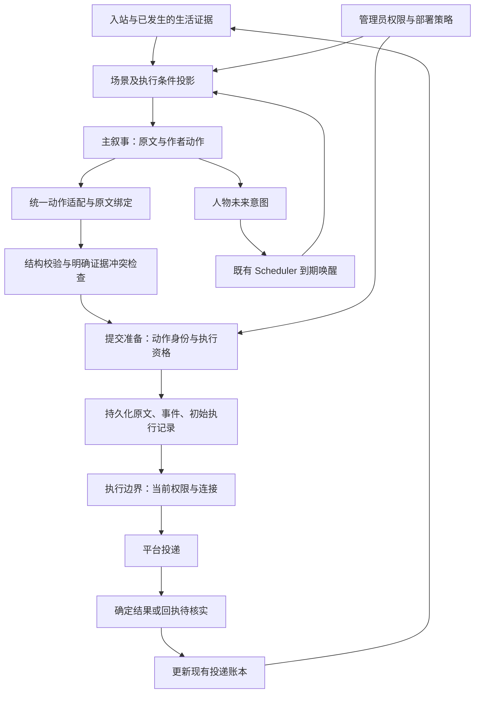

# 主动联系：统一作者动作架构与实施计划

日期：2026-11-14  
源码基线：`1.0.1-rc59-preview.1`  
状态：方案二的架构细化。**P0/P1/P2/P3/P4/P5 已完成**——P5 清理、契约回归、文档同步和发布验收已于 2026-11-15 完成；真实 Console 浏览器与桌面消费者联调仍按外部宿主版本单独记录。本文描述目标行为；当前运行行为以源码和 [AGENCY_WINDOW.md](AGENCY_WINDOW.md) 为准。
修订：2026-11-14 审查后补充——现状断言经源码逐项核验，修正 §2/§4.1/§6.3/§6.4/§9/§10.1 的表述与字段实名；新增 A18 回归项、账本聚合优先级声明、P1 退出条件补充与盲评观察点。  
本次交付：设计文档与文档索引，功能代码、配置、数据库和构建产物保持原状。

## 1. 决策摘要

HDSI 是写作架构。写作质量与主角动作拟真度是本次重构的质量判据。资源和延迟作为实施约束观测，优化服务于原文完整、动作可信与生活连续。

采用方案二：主叙事统一形成当下动作，Agency 转为有来源的行动情境，宿主负责结构一致性、运行权限和实际执行。主动联系属于人物动作的一种，私聊、群聊、跨会话发送共享动作语义，保留各渠道的执行规则。

确定的主要变更：

1. 主动联系意愿数值、联系温度硬规则、按动机类别放行和 Urge 联系加速豁免退出执行许可链。
2. 复用 ScriptCommit、ScriptEvent、动作引用、投递账本与平台适配器，形成统一内部动作；模型输出契约分阶段迁移。
3. Agency 的设备、隐私、活动负荷信息并入场景证据投影；未知、过期和新发生的条件变化具有明确表达。
4. 人物的未来联系意图到期后进入正常写作；已确定动作的技术重试进入投递恢复，两者分别管理。
5. 管理员权限、平台可发条件和可选部署额度继续有效，以运行限制解释。
6. 日志、Console、管理命令、桌面桥接使用同一动作身份和结果语义。
7. 普通成功路径增加零次模型调用；采用现有调度和持久化恢复，避免增加联系专用轮询器或平行账本。

本轮范围聚焦主动联系的形成、规范化、提交、发送、恢复与交互。Alter、长期发展、时间导演、群聊入场算法保持各自后续议题；本轮只修改它们与动作链有关的接口。

## 2. 源码现状与实际影响

以下为本次只读核对得到的现状，行号以基线版本为准。

| 部件 | 当前实现 | 本方案影响 |
| --- | --- | --- |
| `src/narrator.ts`：`agencyInstruction`、`systemPrompt` | 请求 Agency 窗口、联系候选、意愿、结论；不同相位要求不同发送镜像 | 删除重复联系裁决提示，改成情境与统一动作说明 |
| `src/narrative-normalizers.ts`：`normalizeDecision`、`normalizeConversationAction` | `advance` 部分路径在解析阶段按 willingness 丢弃动作，另行记录 dropped actions | 分开语法规范化与执行许可，完整保留合法作者动作 |
| `src/service.ts`：`persistDecision` 约 4420–5110 行 | 提交前合成动作、构建账本，随后进行 Agency 及跨会话过滤，并作未发送补偿 | 将可提前确定的执行结果纳入提交准备，统一处理动作 |
| `src/agency.ts` | 设备、负荷、隐私、最短间隔、动机类别、候选归一化和重查时间混合 | 保留证据解析，退役联系候选与容量裁判 |
| `src/urge.ts` | 调度交接包含意愿值、随机抖动、armed/burst、联系后确认；burst 影响 Agency 间隔 | 保留生活调度，移除联系决策耦合与联系专用状态 |
| `src/intents.ts` | `proactive-check` 是内部唤醒任务；已有承诺、延迟消息、分段投递与研究任务 | 迁移候选重查，保留既有调度与执行恢复 |
| `src/script/*` | 已有 ScriptCommit、原文引用、事件、场景投影和投递账本 | 扩展现有契约，避免新增平行动作系统 |
| `src/delivery/pipeline.ts` | 已有端点校验、取消、执行去重、回执、失败记账和部分恢复 | 接入统一策略与明确的回执不确定状态 |
| `src/story-state.ts`、`src/types.ts` | Agency 窗口、Urge 状态、最近联系计数、未来意图等持久化 | 版本化迁移，保存历史审计和恢复身份 |
| `src/console/*`、`client/src/pages/*` | 概览仍展示 Agency 模式；配置中心当前开放 runtime/research；主配置页仍有重复入口 | 新增相关配置节、动作只读视图、迁移提示；旧入口转到统一来源 |
| `src/logging.ts` | 主要根据中文消息正则识别 Agency/发送等类别 | 新链路使用结构化事件，文本渲染继续兼容 |
| `src/desktop-bridge.ts` | 桥接协议 4，已有能力协商、关联 ID、投递回执 | 增量能力协商与只读动作状态，旧宿主继续工作 |
| `src/share-sync.ts` | 预设白名单包含 runtime/urge/agency；配置分区可整段替换 | 将作者偏好和部署权限分开导入，明确旧字段迁移 |

两个关键现状：

- Agency 的意愿与容量判断目前是本地逻辑，并无独立 Agency 模型请求。因此移除它的直接收益是减少约束、输出字段和分支，而非省掉一轮模型调用。
- 当前已存在真实的执行补偿与投递账本。重构应将这些实现统一起来，并继续保护原文、动作与实际结果的联系。

## 3. 目标数据流与权威边界



| 判断 | 权威来源 | 输出与约束 |
| --- | --- | --- |
| 想起谁、如何感受、此刻是否联系 | 主叙事原文，结合设定、经历和当下情境 | 当前动作、未来意图，或继续其他生活 |
| 设备、地点、活动和隐私条件 | 已发生原文与外部观测，保留来源和时效 | 有证据的条件；缺项表达未知 |
| 是否允许主动出站、跨会话或使用目标端点 | 管理员配置及平台能力 | 可解释的执行资格 |
| 是否重复执行同一动作 | 宿主生成的稳定身份和投递账本 | 一次逻辑动作，各气泡分别记账 |
| 平台是否接受、是否失败 | 实际平台结果或桥接回执 | 确认、失败、部分完成或待核实 |
| 对方是否阅读、理解、同意 | 对应外部证据 | 后续事实；平台接受只证明平台接受 |

已知权限在写作前以简短约束提供给作者；发送前再次复核，覆盖写作期间发生的权限变化。前后复核复用同一个纯函数策略，不重复推导人物动机。

## 4. 统一动作契约：先内部统一，再迁移模型输出

### 4.1 复用边界

继续使用 `src/script/contract.ts` 中的既有提交与事件契约（代码实名 `ScriptCommitDraft`、`ScriptEventDraft`，本文以 ScriptCommit/ScriptEvent 作速记）和消息事件引用。投递的主键沿用宿主生成的 `commitId + eventId + segmentIndex`（账本定位另含 scriptEntryId）。模型的局部动作 ID 仅负责引用本次原文，宿主负责持久身份。

新增一个小型适配模块，建议命名 `src/script/contact-actions.ts`，职责是把旧格式和新格式转换成现有事件构建器的输入。它不持有计时器、人物评分或独立数据库表。

模型的目标通信格式示意：

```json
{
  "script": "……她打开对话框，敲下 <say id=\"a1\">刚才看到一件很好笑的事。</say>……",
  "communicationActions": [
    {
      "id": "a1",
      "target": { "kind": "participant", "id": "listed-participant-id" },
      "timing": "now"
    }
  ]
}
```

`target.kind` 首期限定 `participant | group`；可选 `endpointId` 沿用现有端点所有权与能力校验。具体 JSON Schema 在 P1 冻结，用真实解析测试确认后再改提示词。

内容只写在原文一次；`<say>` 和引用负责提取。小模型的既有 content-only 输出继续通过原文精确绑定适配。相同文字被多个动作引用时，以局部动作 ID 和目标分辨，而非仅比较字符串。

### 4.2 联系标签由宿主导出

模型侧退出 `willingness`、`origin`、`outcome` 等重复批准字段。宿主从当前相位、原始入站归属、目标和已持久化意图，导出：

- `reply`：对真实入站的当前回应。
- `continuation`：有实际对话或承诺来源的延续。
- `initiation`：没有当前回应归属的出站行动。

这些是审计及运行策略标签。平台是否允许主动发起，还必须依据该平台真实的回复窗口、令牌和调用能力确定；一项用户早先提出的请求，也可能在今天需要主动发起资格。

新动作执行资格以宿主来源判定为准。旧 `userInitiated` 字段只在兼容层解析，模型自报的布尔值无法放宽权限。分类未能确定时采用现有较严格的主动出站权限，并记录原因。

### 4.3 当前发送、未来意图和确定延迟发送

三类材料使用现有事件类型与意图存储，执行含义分别为：

| 类型 | 含义 | 到期行为 |
| --- | --- | --- |
| 当前发送 | 这轮已形成、即将尝试执行的动作 | 进入发送管线 |
| 人物未来意图 | 她打算在稍后情境中联系，具体内容尚可改变 | 进入正常作者回合重新处理 |
| 确定延迟发送 | 有明确发送时刻及已授权固定内容的任务，例如既有确定提醒、已确认分段 | 校验时效和权限后执行固定动作 |

未来意图使用 `future-intent` 事件和 `interlude_intent`。建议采用现有可扩展 type 下的 `contact-plan`，新增 payload 字段仅包括原始来源引用、目标、到期和到期后的明确处置。普通人物计划沿用既有意图执行入口，不增加新的叙事相位。

模型新格式的具体字段在 P1 与已有 intents 输出一并定稿；同一计划由统一适配器去重后形成一个 future-intent。旧 `delayed` 的语义按原始任务保留，迁移时依据其创建来源区分。来源不足的旧任务维持既有权限及行为，并在 Console 标明“历史延迟任务”。

### 4.4 多目标和多气泡

同一段生活可以自然包含给多人的动作。每个逻辑动作独立拥有目标、事件、额度记录和结果；一个目标失败，其余目标按原文顺序继续处理。单个动作的气泡共享 eventId，分别使用 segmentIndex。

额度按逻辑动作计数，同一动作的多气泡、重试与回执更新共用一条占用。不同动作即使文字相同，也保留各自身份。隐私回声保护、目标授权和群配置继续有效。

## 5. Agency：并入有来源的场景条件

### 5.1 目标职责

保留 `activityLoad`、`privacy`、`deviceAccess` 的含义与历史来源，逐步投影至已有 `SceneFrame` 的 attention、privacy、deviceAccess 等字段。作者通过 `currentSceneEvidence` 读取一份条件视图。

过渡期间继续读取旧 `StoryState.agencyWindow`。状态保存仍可保留该缓存，避免大规模重建历史；它只提供原始证据，场景投影是模型和 Console 共用的读视图。旧 `agency.enabled` 随兼容层退役，当前场景证据功能成为常规连续性能力。

设备信息应能关联具体端点或设备来源。例如手机不可用仍可能有一台可用电脑，单一全局设备枚举只提供已知局部事实。

### 5.2 时效、来源和变化

每个可用条件携带来源条目、观测时间、有效期及设备范围。确定性投影按来源时序和场景转移选择：

1. 当前已发生的外部观测。
2. 本轮原文明示的条件变化，例如取回手机、离开会议室。
3. 尚有效的历史原文证据。
4. 未知或已过期状态，保留相应标记。

新变化只更新相关字段。隐私、设备和活动具有各自时效，一份旧窗口的整体更新时间不能让所有字段重新变新。相同证据只注入一次。

新原文中的可结构化交接可扩展既有 `lifeHandoff`：仍使用精确原文引用，附可选设备/端点范围。原文引用证明来源存在，无法单独证明整段叙事语义正确；宿主只作有限结构校验。

### 5.3 动作条件的处理

| 情况 | 处理 |
| --- | --- |
| 忙碌、设备访问受限、共享空间 | 作为具体情境供作者选择时机、渠道和表达 |
| 缺少窗口或条件过期 | 显示未知，继续以可见原文写作 |
| 原文明确取回设备后发送 | 承认本轮新变化，形成连续动作 |
| 明确渠道不可用、目标无权访问或管理员禁用 | 执行限制，保留原因 |
| 明确且可确定识别的结构冲突 | 提交前恢复或停留在未提交状态 |
| 需要心理或语义猜测才能判断的冲突 | 留给作者；可记录诊断样本，后续评估 |

第一期以结构、时序、目标和来源检查为主。对自由文本矛盾不作泛化关键词裁判，也不增加通用心理评分。只有既有主模型恢复路径适用于该明确错误时，才合并为一次有界恢复；普通成功路径直接提交。

## 6. 执行策略与提交顺序

### 6.1 策略作为部署边界

保留 `runtime.allowProactiveMessages` 为后台主动可见消息的总开关，保留 `sharedStory.allowCrossConversationMessages`、账号/用户/群白名单及端点权限。旧开关的具体相位覆盖在 P0 用特征测试固定，再作逐项迁移。

新增集中配置节 `deliveryPolicy`，仅承载可选运行额度，例如主动出站的每目标滚动 24 小时上限、最短运行间隔与延期有效期。新安装的额外联系额度默认关闭（0 表示无额外额度约束），原有总开关和渠道权限继续作为前提。

本地额度不描述主角人格。命中运行间隔时，系统只在仍有效、明确可延期的动作上安排执行延期；普通当下分享默认以本次未执行结束，后续生活看到结果后再决定。策略解除后恢复的是可延期的固定动作，新的文学决定继续由正常写作形成。

### 6.2 两次检查与一致性

写作前的执行条件快照包含 `policyRevision`；模型生成期间配置可以更新。提交准备按最新 revision 计算资格，发送前再次读取当前策略和端点状态。

复核覆盖真实的时序变化，使用同一 `evaluateDeliveryPolicy`，每次返回明确原因、适用对象、revision、可选下次执行时间。行动批准与心理状态分开。

### 6.3 推荐提交步骤

1. 使用真实入站、既有事实和最新策略准备上下文。
2. 主叙事生成原文与动作；旧格式通过同一个适配器规范化。
3. 对动作进行原文绑定、目标、时间、事件关系及明确结构冲突校验。
4. 宿主生成稳定事件身份，按最新权限形成每个动作的执行结果。
5. 在现有故事串行链中持久化原文、事件、初始账本及可选额度占用。
6. 持久化成功后执行外部调用；平台 I/O 位于数据库事务之外。
7. 回执更新同一账本；只有确定平台接受的内容成为 delivered message。
8. 将可观察的执行结果投影给后续写作；内部策略原因留在运维观测。

提交原子性优先复用数据库短事务与既有 dbWrite 封装。已核验的现状：全树仅整理管线（compaction 经 dbWrite → withTransaction）使用事务，主动发送提交目前不在事务内——`persistDecision` 的 `appendEntry` 为单行 dbCreate，原子性来自单行写入加故事串行队列。因此"以单行 script 元数据保存原文、事件和初始账本作为恢复根，再幂等更新外围状态"不是兜底退路而是现状基线，P1 在此之上补齐短事务；驱动缺少所需事务能力时沿用该恢复根方案；精确部署额度的并发保证须通过支持驱动验收。

### 6.4 原文与投递事实

原文可以描述当下形成并尝试执行的动作，平台接受由回执确认。已知限制提前给作者；写作期间变化或投递时出现的新限制，以系统执行事实记录。

原文一经提交，保留原貌。deliveryReality/知识证据投影使发送尝试、确认送达、未发送和待核实分别可见，后续记忆、承诺判断与召回采用这些事实。

"把原文写到发送当作对方已收到"的修正范围已经源码核验，比原先的整类列举小：承诺判定、交往节奏印象、主动联系配额确认与知识证据 confirmation 角色均已按账本 delivered 门控（仅在确认送达后应用），无需重做。剩余前置缺口为四个触点，这一组是启用新链路的前置条件：

1. 知识证据 observation 子句：`script` 原文引用（含未送达的发送描写）当前不被降级——仅 confirmation 角色降级为 interpretation；需让 observation 的 delivered 依据查询投递账本而非条目 kind。
2. 召回与压缩的送达标注：召回摘录的 RECALLABLE_ENTRY_KINDS 含 `script` 且无逐段送达标注；压缩 payload 已带 deliveryReality 提示，但该投影默认仅保留最近 8 个动作/2000 字符，窗口外原文无标注，需扩展复用同一投影。
3. 模型自写 memories 直接落库，无送达门控。
4. 提示词层约束（压缩/回忆的"发送描写不等于已送达"）：属契约层而非代码层，压缩摘要本身无解析器可拦截，最终依赖模型遵从——该残余风险在此明示，不承诺结构化强制。

运行限额等内部政策无需投射成人物生活事件。作者只需要知道动作仍未确认完成；是否继续生活、换一种表达或保留未尽之意，由下一回合形成。

## 7. 投递账本、重试和额度

### 7.1 复用现有恢复根

扩展现有 ScriptDeliveryAction/Segment 与事件 metadata；额度占用及策略处置引用同一个 eventId。首期维持现有 script 元数据账本，保持最近有效额度窗口的有界索引；重启时从有效窗口重建。

如果历史规模使现有存储无法满足有界查询，再增加只读索引或账本派生投影。索引可重建，权威仍在原账本；此优化须由测量结果支持。

### 7.2 状态与原因

现有 `pending / delivered / partial / failed / cancelled` 保留。在 segment 层增加明确 `unknown`，动作聚合也支持 unknown。聚合规则按下述顺序求值、取第一条匹配，实施与测试以该优先级为准：

- 全部分段 delivered：delivered。
- 任一分段 unknown：unknown，额外保留已确认分段数量。
- 有确定送达且无 unknown、仍有未完成或失败：partial。
- 全部分段未发送且因权限/取消终止：cancelled。
- 确定失败且没有可继续任务：failed。
- 已排期或可重试的任务：pending。

运行策略阻止以 `cancelled + policy-*` 或明确延期的 `pending + policy-deferred` 记录。Console 将原因域展示为“运行限制”，保留与人物主动放弃的区别。账本状态和原因即可表达的情形，沿用这两项，控制状态数量。

状态更新校验前态和回执身份，成功回执优先合并，重复或迟到失败无法覆盖已确认成功。late receipt、部分成功、取消后迟到成功均保留审计及真实结果。

### 7.3 回执不确定的边界

本地幂等可阻止同一动作的并发重复执行；平台是否恰好执行一次还取决于对端幂等、回执和查询能力。

| 结果 | 行为 |
| --- | --- |
| 调用前确定没有发送，或平台明确可重试失败 | 同一事件按已有退避重试，限有效期与次数 |
| 平台明确接受，本地写入失败 | 复用已收到回执补记账；恢复时优先核对账本和平台证据 |
| 超时、断线、进程退出，调用可能已到达平台 | 标记 unknown，具备平台查询能力时核实；其余保持待核实 |
| 部分气泡确认成功 | 仅处理未确认分段；成功分段身份保持不变 |
| 目标、权限或任务代次已变化 | 发起前重新检查并终止失效动作 |

对 unknown 的人工操作先提供“核实结果/取消后续”；允许人工重新发送时创建可审计的新尝试并说明重复可能性。自动恢复只重发有确定依据的可重试分段。

### 7.4 额度语义

额外运行额度启用时，按逻辑动作在故事串行区内预占：

- 第一次尝试前持久占用，引用 action eventId；多气泡和技术重试复用。
- 发生部分或全部确定送达：该动作计一次。
- 全部确定未送达：释放占用。
- 任一分段 unknown：保留占用至核实或到窗口自然结束。
- 同一人的端点归属规则明确；首期每参与者额度沿用既有 participantId，不在此重构中合并跨参与者身份。
- 群目标独立配置；保留群平台限流及 Qzone 等各自配额，避免误套私聊旧规则。

最近 20 条的旧 `proactiveContactLog` 保留历史读取，但新额度采用完整有效窗口的数据；有效期内的活跃占用完整保留。硬截断只适用于窗口外诊断缓存。

## 8. 人物未来意图与旧主动重查

### 8.1 contact-plan 生命周期

人物计划至少引用其形成的原文事件或条目，包含目标、最早处理时间、可选失效条件与截止时间。到期与普通 due intents 合并为一次正常写作机会。

到期后主叙事可以执行、修订或结束计划；同一计划的终结和新动作提交保持关联。因模型/数据库故障未提交时，原计划保留待处理；成功消费后及时改变状态，防止反复唤醒。

新消息的处理按实际关系分支进行：与同一事项相关的入站可以使计划完成、合并或过时；不相关消息及其他关系分支继续保留原计划。实际关联判断可由下一次正常作者回合处理，宿主只确定性取消已明确替代的任务。

### 8.2 旧 proactive-check 迁移

| 旧任务 | 迁移处置 |
| --- | --- |
| 有原文支持、未过期，确实是人物稍后想再处理的计划 | 转为 contact-plan，保留旧 ID 映射和来源 |
| 仅因意愿阈值、安全间隔或固定 fallback 产生的重查 | 结束旧任务，原因 `legacy-policy-recheck-retired`；需要的未尽事项通过原文继续可见 |
| 已过期、目标失效或已被后续动作替代 | 终结并记录依据 |
| 已有实际动作、处于技术恢复中 | 继续按动作账本恢复；计划迁移与投递恢复分别处理 |
| 来源无法可靠识别 | 保留只读审计，暂停旧重查的自动执行，交下次正常写作重新理解 |

迁移一次扫描、分页和断点执行，带独立 migrationVersion；重复启动保持幂等。完成后 `proactive-check` 退出新增任务类型及运行调度。

## 9. Urge 收敛为生活推进调度

保留生活节奏五档、对话密度、休息窗口回退、频率档位、基础间隔、下次推进时间及基础退避。它们影响何时再观察生活，保持既有调度的最早唤醒仲裁。

删除主动联系专用的 `value`、`proactiveWillingnessThreshold`（解析名 willingness）、armed、spent、contactMin（解析自 burstContactMinMinutes）及联系后确认依赖；移除 `extremeChance` 和针对意愿值的 jitter。`burstThreshold / burstTtlMinutes / burstBudget` 随原联系 burst 退役。失去消费者的 hotMin/hotMax 一并退出表单。

新的可选写作交接只保留：当前生活节奏、slow/normal、建议下次生活处理间隔、原文 basisQuote。某些短回合可沿用新鲜的既有生活节奏，减少机械输出。

确有连贯交谈时，普通入站/后续回合和现有 Scheduler 继续推进；需要连续的独立生活场景时，用短的建议间隔表达。调度抖动只作用于后台唤醒，明确到期承诺及有效截止时间优先。

Urge 状态迁移清理旧联系 burst，并重新计算下一次普通生活唤醒。已确认动作和技术恢复保留原身份。生活节奏投影继续供群聊 auto 档消费，其语义与枚举保持兼容。

## 10. 删除、重写、保留清单

### 10.1 退出新运行链的内容

| 项目 | 对应位置 | 退场方式 |
| --- | --- | --- |
| runtime/urge 的 proactiveWillingnessThreshold、Agency naturalWillingnessThreshold | `src/index.ts`、`src/service.ts`、`src/urge.ts` | 隐藏兼容解析一个迁移周期，退出运行和提示词 |
| contactMode、按模式变化的间隔与动机教义（阈值/间隔放宽的实际执行点在 persistDecision 裁决段） | `src/agency.ts`（配置归一）、`src/narrator.ts`（动机教义）、`src/service.ts`（裁决效果） | 形成迁移说明与可选作者参考草稿，退出硬裁决 |
| evaluateAgencyCapacity 的容量否决 | `src/agency.ts` | 已删除；Agency Window 保留场景条件投影，统一策略与端点边界负责执行资格 |
| ProactiveContactDraft、normalizeProactiveContact、候选指纹/专用重查时间 | `src/types.ts`、`src/agency.ts`、`src/intents.ts` | 旧草稿解码与 contact-plan 适配保留；候选容量裁决、指纹和专用重查排期退出运行链 |
| willingness 解析丢弃与专用 dropped/withdrawn 补偿路径 | `src/narrative-normalizers.ts`、`src/service.ts` | 完整作者事件与策略结果替代；其他真实失败补偿继续保留 |
| 单个 agencyCandidate 选择及“not-selected-by-agency”等后置过滤 | `src/service.ts` | 对每个事件独立求执行资格 |
| 意愿触发的合成动作、合成候选特殊豁免 | `src/service.ts` | 兼容适配器提取明确目标和有原文绑定的动作 |
| proactive-check 新增与轮询 | `src/intents.ts`、`src/service.ts`、intent-lifecycle | 新生产者和轮询已删除；历史 pending 任务由迁移命令与兼容消费处理 |
| Urge 联系 burst 与随机意愿 | `src/urge.ts`、`src/story-state.ts` | 按第 9 节退役 |
| proactiveContactRef 专用计数及失败作废 | `src/types.ts`、`src/delivery/pipeline.ts` | 已删除；统一 eventId 与投递账本负责额度占用、结算和恢复 |

删除边界以消费者为准。表情、贴图等其他功能的 willingness 字段具有各自职责，本轮限定通信许可链，逐项确认引用后处理。

### 10.2 重点重写的内容

| 组件 | 目标 |
| --- | --- |
| narrator prompt 与 payload | 一次作者动作、简明执行边界、一份情境来源；支持已有 specialty 裁剪 |
| normalizers | 语法和目标规范化；执行限制独立返回，保留作者意图 |
| persistDecision | 规范化—绑定—策略—提交—执行的顺序；多目标和各种相位统一 |
| scene-frame / life-handoff / context-compiler | 新鲜条件投影、原文交接、消除 Agency 重复注入 |
| delivery pipeline / ledger / reality | 统一策略、unknown、额度结算、恢复与投影 |
| intents / intent-lifecycle | 人物计划与技术恢复分流，到期聚合、取消和迁移 |
| logging / Console / desktop bridge | 统一身份、原因域、只读状态、操作边界及兼容 |
| Schema / story-state / share-sync | 版本化迁移、字段退场、部署策略与创作预设分离 |

### 10.3 继续保留的基础

- Scheduler 的最早唤醒、串行、代次取消、退避和任务生命周期。
- ScriptCommit、原文锚点、事件因果、SceneFrame、DialogueBurst、投递账本与 deliveryReality。
- PlatformAdapter、端点所有权、平台发起资格、白名单、权限和真实回执。
- 用户入站、承诺、生活日程、原文召回和长期记忆的既有来源边界。
- 分泡、流式当前回复、真实工具观察、Typing 模拟；按第 11 节分别接线。
- Qzone、表情、研究、世界播种等外围能力的现有执行策略。

## 11. 相位、流式和旁路接口

### 11.1 全入口覆盖表

| 入口 | 统一方式 | 特别保护 |
| --- | --- | --- |
| advance 的私聊/群主动动作 | 统一作者动作及执行策略 | 总开关、群后台参与资格和端点发起能力 |
| user-message 的当前回复 | 同一内部动作，宿主标识真实回应来源 | 已有低延迟、当前端点和白名单 |
| user-message 的其他目标动作 | 每个目标独立求权限 | 当前入站无法替其他目标授予主动权限 |
| conversation-follow-up | 保留对话来源，使用统一动作 | 当前语义与既有总开关关系先固定再迁移 |
| intent-due / contact-plan | 正常作者回合生成新当前动作 | 平台主动资格按当时能力复核 |
| delayed / split-message | 执行既有确定动作 | 同一身份、分段结果和新消息取消 |
| ledger recovery | 恢复实际动作 | unknown 先核实、过期与代次保护 |
| 管理命令/桌面直接发送 | 显式管理动作仍走最终执行边界 | 身份可审计，权限真实有效 |
| Qzone 等功能动作 | 保留原独立动作与配额 | 与通信额度分别计算 |

### 11.2 流式提前回复

保留当前真实入站回复的 earlyReply 路径，新增主动或跨目标动作在完整原文及目标绑定后执行。流式回复的稳定动作身份在首次发送前确定并记录，最终原文回填引用同一动作；后续恢复只补原文或结果。

当前主叙事还存在真实浏览观察后的二次写作与输出恢复，本次分别保留。它们的真实新增事实或结构恢复意义，与主动联系重复裁决不同。

已发送部分无法撤回，后续模型失败以已有恢复机制补齐原文。目标重构应保证“已发出的当前回复”不会在最终提交时被重复动作覆盖，亦不会因为新的主动开关被当作后台发送处理。

### 11.3 权限与元数据贯穿

宿主关联身份包括 storyId、commitId、eventId、segmentIndex、traceId、processingId。涉及延迟和恢复时，必要身份持久化，而非只依赖进程 AsyncLocalStorage。

权限快照可以缓存，但缓存键须含 policyRevision、端点注册表修订和任务代次；最终平台调用前继续复核。账号禁用、目标删除、运行暂停、mute 和全库清理都能终止后续执行，已发生的平台接受则保留真实回执。

## 12. 配置与历史数据迁移

### 12.1 配置目标

| 类别 | 目标位置 | 含义 |
| --- | --- | --- |
| 总权限 | 既有 runtime/sharedStory/账号群端点配置 | 允许哪些动作和目标 |
| 可选部署额度 | 新 `deliveryPolicy` 节 | 运行间隔、滚动额度和延期有效期 |
| 作者联系参考 | `sharedStory.contactGuidance` 可选文本 | 作品对联系表达的偏好，默认空；作为作者参考而非 Canon 或评分 |
| 生活调度 | 精简后的 urge | 下一次观察生活的时间 |
| 当前行动条件 | SceneFrame 的来源投影 | 实际条件的只读视图 |

优先把新增配置放入已有 sharedStory 与独立运行策略节，控制新配置数量。contactGuidance 首期为全局作品参考；具体关系仍由已有参与者资料和关系设定表达。Console 文案明确区分正在运行的作品、插件默认模板和运行策略。

### 12.2 旧字段映射

| 旧字段或状态 | 迁移结果 |
| --- | --- |
| allowProactiveMessages / allowCrossConversationMessages / 白名单 / endpoint.enabled | 原值和边界保持，先完成端到端回归 |
| agency.enabled | 旧规则是否曾实际生效的迁移依据；退出新式场景证据开关 |
| agency.proactiveDailyCap | 仅对旧链路实际启用且实际受控的目标迁入运行额度 |
| minimumProactiveIntervalMinutes / naturalMinimumIntervalMinutes | 依据旧 contactMode 的有效值迁移为运行间隔；明确记录原先承诺豁免及新运行语义差异 |
| contactMode | 生成可查看的作者参考迁移草稿；用户原有 contactGuidance 优先，默认 strict 不自动写成新教义 |
| willingness 阈值 | 保存迁移前配置供审计，退出有效配置 |
| maxWindowMinutes | 作为旧条件缓存的时效上限，后续交由各证据时效替代 |
| maxCandidateHours | 仅用于旧候选迁移的失效上限，新人物计划按其具体语义限时 |
| agencyWindow | 有效来源逐字段投影；过期信息显示过期，缺失信息显示未知 |
| proactiveContactLog / ref | 历史审计及窗口内额度迁移依据；新动作改用 eventId |
| urge 联系状态 | 退役并重算普通推进时间，已提交动作保持 |

重要兼容细节：Koishi Schema 默认值可能已经写入或展开，单凭字段存在无法区分管理员显式设置与旧默认值。迁移使用“旧链路实际开启和有效行为”作为依据，迁移摘要展示来源和差异；无法恢复的显式意图标为不确定，交由管理员在新表单调整。

旧安全间隔按“任何上次发言”计算、承诺可豁免；新运行间隔针对逻辑主动动作。这是可见的行为语义变化。迁移摘要单列，首次切换保留等效的保守限制或既有有效豁免来源，待管理员明确调整后再使用新策略。保留方式须在 P1 由配置样本和特征测试冻结并纳入 A18 回归，避免隐式扩大出站许可。

### 12.3 配置迁移的执行顺序

1. 读取原始配置与持久状态，先在内存生成迁移预览及快照。
2. 配置解析兼容层在新运行路径启用前提供有效新策略，保护迁移中途的权限。
3. 通过统一配置更新管线持久化；在写入前验证新 Schema。
4. 分页迁移旧任务和活跃额度，独立记录阶段与版本，重复运行保持幂等。
5. 新写入采用新契约，历史读取兼容继续一个发布周期，退场时间在变更日志明确。

当前 StoryState 版本为 5；实施时使用当时最新版本递增，避免提前硬编码下一版本。动作契约、账本、配置迁移分别带版本与兼容检查。

### 12.4 预设与回退

`share-sync.ts` 增加新字段识别。创作预设可携带 contactGuidance 和生活调度；部署权限及额度仅在管理员明确选择“包含运行策略”的应用范围时采用，常规创作导入保持当地权限。旧预设中的 agency 模式进入兼容预览，避免重新激活旧评分链。

回退以发布前配置快照和数据库快照为恢复点，回退程序前恢复匹配版本数据。新旧程序对同一库的并行写入限制在兼容性验收通过的情形；在已有平台副作用之后，单靠回退数据库无法撤销已发消息，恢复前需核对该时间段的回执和账本，明确处理可能重复的旧待发任务。

## 13. 日志重写

### 13.1 结构化核心，沿用现有展示

给新的联系事件增加可选结构字段，由同一对象渲染 Koishi 文本、Console 及桌面事件：

```ts
interface CommunicationEventLog {
  type: 'action-authored' | 'action-policy' | 'delivery-result'
      | 'contact-plan-updated' | 'migration-summary'
  storyId: string
  commitId?: string
  eventId?: string
  segmentIndex?: number
  intentId?: number
  traceId?: string
  processingId?: string
  targetId?: string
  endpointId?: string
  domain: 'authoring' | 'policy' | 'transport' | 'integrity' | 'migration'
  reasonCode: string
  status: string
  policyRevision?: string
  elapsedMs?: number
}
```

类型为设计草图，具体字段复用现有事件/日志类型。`LayeredLogInput` 增加可选显式 action 与结构数据；旧消息继续正则分类，新链路按显式类型展示。

“本轮继续生活”是成功写作结果，通常只需回合完成摘要。只有发生动作、计划变化、限制或异常才发对应动作日志。调度采样放 diagnostic，普通级别按逻辑动作合并输出。

### 13.2 读者可理解的文案

| 场景 | 标准日志示例 | 诊断细节 |
| --- | --- | --- |
| 形成动作 | `[作者动作] 已形成当前消息 目标=… 动作=…` | 原文绑定、来源、分类 |
| 部署限制 | `[运行限制] 当前消息暂未执行 原因=滚动额度 目标=…` | policyRevision、占用引用 |
| 确定发送 | `[投递结果] 平台已接受 动作=… 分段=1/2` | 回执 ID、端点、耗时 |
| 回执不确定 | `[投递待核实] 动作=… 原因=调用超时` | 尝试身份、可查询能力 |
| 计划变化 | `[生活计划] 联系计划已调整 计划=…` | 来源、到期、完成动作引用 |
| 迁移 | `[配置迁移] 已迁移运行额度；旧意愿字段已退役` | 旧新字段映射、阶段和版本 |

删除“意愿不足＝主角不想联系”“额度触顶＝自然放下”等混合解释。人物自己的放弃由原文或计划更新表达，权限与传输原因各自归类。

默认日志只显示有限目标标签和关联 ID，完整消息正文沿用已有隐私预览配置。禁止把模型推理链作为日志内容；动机展示仅引用可见原文或简短动作依据。

## 14. Console 与管理交互

### 14.1 概览

调整 Overview 的 Agency 模式行，展示三类独立信息：

- 后台主动出站：允许/关闭，以及生效配置来源。
- 当前行动条件：设备、隐私、活动；每项显示时间、来源及未知/过期。
- 动作结果：近期已接受、待执行、受运行限制、待核实数量；可展开最近动作。

Urge 提示改为“生活推进调度”，与发送许可分开。普通的关闭状态作为中性配置显示；只有执行故障和无法完成的操作使用警示。

### 14.2 动作只读视图

在 HDSI 现有页面内部增加一个“通信动作”页或等价详情区域，优先复用 DataRow 和现有路由壳。每条记录包含：

- 时间、目标和渠道，当前动作/人物计划/确定延迟任务。
- 原文条目链接及动作引用，绑定结果。
- 平台结果、各气泡状态、运行限制原因。
- 计划来源及到期，下一次处理时间和是否仍有效。
- unknown 的核实提示及可用能力。

列表按游标分页，详情按 eventId 惰性读取。只读视图从现有账本和计划派生，避免另外维护 Console 状态机。概览只取有界摘要。

拟增共享 RPC：`hdsi/actions/list`、`hdsi/actions/get`，契约放 `src/console/contract.ts`，读写权限沿用本项目既有 read=1 / write=3 体系，身份认证继续由 Console 提供。敏感字段按权限和既有脱敏规则投影。

### 14.3 配置中心

相关节本次开放：

| 配置节 | 展示与编辑 |
| --- | --- |
| runtime | 保留主动出站总开关，移除意愿阈值说明 |
| deliveryPolicy | 可选运行额度、统计口径、当前有效值与迁移来源 |
| urge | 精简生活调度字段，删去联系 burst 和失效 hot 参数 |
| sharedStory | 联系作者参考与既有跨会话设置；依完整 Schema 开放并复核权限 |
| 旧 agency | 兼容期显示迁移说明、旧配置只读和新入口 |

Schema 继续作为字段事实源。沿用 `SchemaBase.Form`、保存前 Schema 预校验和 `updatePluginConfig` 持久化管线，开放节通过 contract 元数据 stage 与服务端白名单同步。保存成功以配置持久化和重载后的有效值确认。

旧 ConfigPage 的 runtime/research 表单按节逐步改为跳转，先统一本次受影响的通信配置；故事档案编辑继续保留独立语义。与本次无关的全部配置页面迁移另行安排。

界面继续保留请求代次、切节丢弃旧结果、卸载取消和失败重试。表单保存校验错误、数据读取失败、插件重载中分别显示。新 RPC 及表单联动必须覆盖近期 Console 修复的回归测试。

### 14.4 管理操作

首期复用 `interlude.status`、`interlude.memory.intents`、`interlude.memory.cancel`：状态展示改用统一投影，计划可取消，固定消息取消标识后续执行已终止。可增加 `interlude.actions [limit]` 只读命令，复用同一查询方法。

Console 的首批可写动作限定为取消未来计划/未执行后续分段，以及具备确定依据的回执核实。控制命令复用与聊天相同的身份授权和故事串行区，携带当前版本，重复点击保持幂等。

人工“再次发送”在 unknown 场景应提示可能已发送，需要明确操作；该操作是独立管理意图，写新尝试审计。普通明确未发送的技术重试仍走既有恢复链。管理操作结果更新原账本，网页本地状态只作展示。

## 15. 桌面桥接、预设站与其他消费者

### 15.1 插件侧桥接

当前桌面桥接协议为 4。首期优先采用增量 capability，例如 `communication-actions-v1`：新宿主可请求动作列表/详情与结构化状态，旧宿主继续接收现有快照和文本日志。

现有 delivery-result 的 sent/retryable-failed/permanent-failed/unknown 对应到账本确定结果。未知结果和延迟回执测试覆盖协议兼容；新旧消息 ID 与 traceId/processingId 在持久恢复后仍可关联。必要结构变更通过明确版本与能力协商发布。

### 15.2 桌面消费者影响已核实的范围

本地 `C:/dev/HDSI-desktop-typ-0-cev/desktop/src/main/main.ts` 约 634–641 行存在 proactiveThr、contactMode、naturalThreshold、naturalInterval、proactiveDailyCap 等配置控件，需要跟随移除或迁移，并使用同一配置映射。

`C:/dev/HDSI-desktop-typ-0/desktop/src/main/main.ts` 的本次同名字段搜索未命中，不能据此推定整个桌面主线无影响。实施时分别核对桌面配置目录、渲染器、preload、stories/runtime、插件副本和打包同步清单，以实际部署版本建立兼容矩阵。

本方案把桌面联动列为独立验收子项；插件可以先以旧协议兼容模式运行，声称桌面完整支持之前须通过真实消费者联调。实验分叉 hds-interlude-cev 也需确认独立命名空间及迁移来源，避免跨库或跨配置误应用。

### 15.3 预设与用户文档

- `src/share-sync.ts`、站点预设 Schema 及桌面配置目录统一识别迁移版本与字段退役。
- 既有预设导入先做本地预览，创作参考与运行权限分别列明。
- 更新 `docs/AGENCY_WINDOW.md` 为条件投影说明，旧门控行为迁入历史章节。
- 更新 CONFIGURATION_GUIDE、BEGINNER_GUIDE、DEPLOYMENT_GUIDE、command.md、ARCHITECTURE、Urge 实施说明与 CHANGELOG。
- root package.json 的 files 白名单加入本设计文档；实际实现的打包验收核对 lib/client-dist 与文档完整性。

## 16. 资源消耗与延迟控制

### 16.1 能确切减少的工作

- 模型退出重复的联系候选、意愿数值、结论与镜像内容输出；原文引用统一表达可减少输出重复，收益按实际 token 统计。
- 移除只由旧阈值、冷却和 fallback 产生的主动重查，减少无新增生活证据的唤醒及潜在模型回合。
- 策略初始结果进入提交，减少过滤后取消、专用补偿条目和计数作废的重复写入。
- 同一次准备阶段并行读取独立数据；参与者、端点和场景在本回合内使用有版本的缓存。
- Console 订阅有界摘要，详情分页读取；正常 UI 轮询与写作链分离。

### 16.2 首期执行预算

| 项目 | 预算与实现 |
| --- | --- |
| 普通成功联系 | 主叙事调用次数相对当前不增加，新增固定前置请求为 0 |
| 情境投影与策略 | 本地纯函数；批量准备数据；复杂度与本轮动作/可见证据数量线性相关 |
| 特殊恢复 | 复用已有有界恢复，总恢复预算与现有链合并，避免各模块各加一次 |
| 提交 | 一次短提交准备及持久化批次；每逻辑动作创建一次身份与额度占用 |
| 投递 | 保持已有端点顺序、分泡和 Typing 语义，平台 I/O 位于 DB 事务之外 |
| 日志/Console | 标准级按动作合并；窗口内内存摘要有界，历史查询按需 |
| 调度 | 复用现有 Scheduler 和 intent due；截止时间优先于随机抖动 |

性能预算是验收目标，具体毫秒值在 P0 基线采集后确定。减少本地判断耗时通常远小于模型和网络耗时，设计不预报未经测量的倍数收益。

### 16.3 分别测量等待来源

记录 queueWait、contextRead、narrator、parseBind、policy、commit、typingHold、transport、receiptReconcile 和 consoleQuery。已知的时间导演、浏览器二阶段写作和平台延迟分别归因，本重构仅统计自身增量。

固定样本比较：输入/输出 token、每成功回合模型请求数、无效重查数、逻辑动作数、数据库读写数、平台尝试数、p50/p95 首次发送与账本收敛延迟。高负载测试还记录旧目标任务是否阻塞当前回复。

缓存和批处理优化以副作用顺序为前提。精确权限复核、持久恢复根、原文绑定和 uncertain handling 是正确性工作，持续保留。

## 17. 可行性、风险与验收

### 17.1 可行性依据

项目已具备原文引用、ScriptCommit/事件、投递账本、端点注册表、代次取消、旧任务唤醒、数据库写队列、Console RPC、配置持久化和桌面能力协商。新增工作主要是收敛现有职责，并给事实结果补齐契约。

难点集中于：原文与执行事实的共同呈现、旧权限的语义迁移、unknown 回执、流式提前发送、多目标和崩溃恢复。通过独立契约、真实主机回归和故障注入逐项验收。

### 17.2 回归矩阵

| 编号 | 场景 | 必须成立 |
| --- | --- | --- |
| A01 | 作者有当前发送动作，缺失或低 willingness | 新链保留动作，执行仅受真实权限与条件影响 |
| A02 | 有/无 proactiveContact、旧/新格式 | 相同明确动作归一化为相同事件语义 |
| A03 | Agency 关闭、缺失或过期 | 无中性“全可用”伪事实，也不导致所有动作消失 |
| A04 | 忙碌、公共空间、设备受限 | 作者可以写符合情境的行动；来源保持清楚 |
| A05 | 取回设备、改用电脑等本轮变化 | 旧条件不会覆盖新原文；端点权限仍有效 |
| A06 | 总开关、跨会话、名单、群规则、端点失效 | 每入口权限正确，旧配置原有禁止范围保持 |
| A07 | 多目标，一项受限或失败 | 动作分别记账，其他合法动作按原文顺序执行 |
| A08 | 多气泡、同文不同动作、同动作重试 | 额度按动作；稳定身份区分重复执行和真实重复表达 |
| A09 | 调用前失败、接受后 DB 失败、超时未知、晚回执 | 正确聚合状态；unknown 自动核实，确定成功保持 |
| A10 | 计划到期、新消息介入、无关分支来信 | 计划正确消费、修订、保留或取消 |
| A11 | 写作中改配置、pause/mute、清库、重启 | 执行边界与代次生效，已失效动作进入明确终态 |
| A12 | 流式已发、主模型后续失败、原文恢复 | 已发动作保持单一身份，补写原文与结果 |
| A13 | 历史 pending/split/delayed/proactive-check | 幂等迁移及正确恢复，内容和来源不丢失 |
| A14 | 额度并发、重启、部分成功、unknown、释放 | 实际窗口完整，额度准确且无重复占用 |
| A15 | Console 切节乱序、保存错误、重载、重复点击 | 读取/操作结果一致，配置落盘，错误可恢复 |
| A16 | 旧桥接/新桥接、旧预设/新预设 | 能力协商清楚，既有权限保持 |
| A17 | 压缩、事实提取、回忆和承诺判定 | 未执行/待核实动作不会成为对方已收到或已同意 |
| A18 | 命中最短运行间隔/额度的首个切换期 | 首次切换保留等效保守限制或既有豁免来源；新旧行为对照（旧：阻止并排重查；新：未执行结束或明确延期）逐项记录，未隐式扩大出站许可 |

定向测试扩展现有 agency-queue-regressions、issue-17-proactive-agency-fallback、agency-endpoint-observability、delivery-ledger、delivery-boundary、delivery-pipeline-characterization、endpoints、urge、dialogue-burst、console-page-integration、console-config-center、desktop-bridge、share-sync 等实际存在的对应测试文件。旧测试按新契约重写，保留它们覆盖过的真实故障条件。

故障测试使用既有 delivery-host/内存 adapter 并接入真实 service 路径，覆盖断点落库和恢复；仅测试新纯函数不足以证明集成链可行。精确额度至少使用本项目实际 SQLite 驱动与单进程部署验证；多进程共享同一库需要独立原子占用机制及专项测试，首期部署范围明确为当前单进程故事串行模型。

### 17.3 文学验证

固定同一设定、生活材料、时间窗和入站事件，对旧链与新链输出进行盲评。评审关注动机是否来自生活、动作是否具体、时间与设备是否可信、关系表达是否符合原文、生活是否连续。发送次数和主动率仅记录为观察值。

样本包含自然的小分享、忙中短句、无人回应后的不同选择、保持沉默、改变原计划、渠道受限等，并专门观察"运行限制多次未执行同一发送意愿后，作者是否收敛发送描写或转向其他生活表达"——这是原文与执行事实长期并存（§6.4）的张力下，新链路文学质量的关键观察点。新链允许多种合理选择，验收不预设“更常联系”或“更少联系”即质量提升。

## 18. 分批实施计划与退出条件

### P0：特征基线与协议冻结准备

- 固定现有所有相位、入口、权限与旧配置样本，记录解析→提交→发送的动作去向。
- 采集第 16 节基线，检查 memory/recall 对送达事实的消费者。
- 列出桌面实际使用版本和插件副本，确认 AGENTS 与本地工作流。
- 建立配置及数据库快照和不可确定平台副作用的恢复步骤。

交付：可重跑基线、权限覆盖表、旧任务分类与性能测量记录。当前文档为设计材料，不等同于 P0 已完成。

### P1：统一内部动作与新结果契约

- 新增单一适配器；旧格式作为输入，统一内部事件作为输出。
- 扩展账本 unknown、策略原因和身份；完成聚合与持久恢复。
- 冻结 communicationActions、contact-plan 和迁移配置 Schema。
- 原文/送达消费者先接入新结果视图。

退出条件：新旧动作适配一致；确定结果/unknown/历史读取回归通过；既有 delivered 门控消费者（承诺判定、节奏印象、配额确认）在账本新增 unknown 后行为不回归——现有消费均为正向 delivered 检查，unknown 应自然落入未确认，仍需回归证实；发布链仍用旧裁决，无新增平台副作用。

### P2：统一执行边界与配置迁移

- evaluateDeliveryPolicy 覆盖各入口，加入额度预占与结算。
- 迁移实际生效的运行限制、已存在任务和活跃额度。
- 将提交和发送复核接入统一策略，保留稳定身份。
- 提供只读 shadow 比较：计算新结果但沿用旧结果执行，差异仅进诊断。

退出条件：权限、数据库故障、重启、额度和多目标回归通过；shadow 没有新增发送，差异原因逐项解释。

**P2 首批实施记录（2026-11-14）：**

- **策略纯函数**：新增 `src/script/delivery-policy.ts`——`evaluateDeliveryPolicy`（每目标滚动 24h 上限、最短运行间隔、延期有效期；每次返回原因/目标/revision/下次可执行时间；A18 首期保留旧链 promise/practical 间隔豁免）、`deliveryPolicyRevision`（配置变化即失效旧判定）、额度结算语义（pending/delivered/partial/unknown 占用，failed/cancelled 释放，unknown 保留至核实）。
- **额度窗口**：P3/P5 运行链以投递账本作为唯一额度来源；`policyActionRecordsFromLedger` 派生完整有效窗口，重启可重建，不受诊断窗截断影响（§7.4）。旧 `proactiveContactLog` 仅由状态解码器保留历史可读性。
- **配置节**：`deliveryPolicy` Schema 提供额度、间隔和延期有效期；P5 移除已完成使命的 `shadowCompare` 字段与发送前 shadow 复核。服务层继续以显式策略优先；全默认值沿用旧 Agency 实际生效限制的保守迁移依据，旧配置仍可读取。
- **旧限制迁移映射**：`migrateLegacyRunLimits`——Agency 未启用迁移为全 0（新旧等效：都不约束）；strict 取安全间隔、natural/balanced 取模式有效较小值；豁免保留与"任何上次发言 vs 逻辑主动动作"的语义差异记入 notes。`interlude.policy` 只读命令展示有效策略、来源（显式/派生）、旧链对照与迁移预览。
- **P5 清理**：发送前 shadow 接线、`policyActionRecordsFromContactLog`、旧 `proactiveContactRef` 失败作废和旧 Agency 预记路径已删除；实际投递只使用 ScriptCommit/Delivery Ledger 身份，额度结果直接进入统一执行边界。
- **回归**：`test/proactive-unification-p2.test.ts` 覆盖配置钳制、revision、账本窗口、上限、间隔、延期有效期、迁移矩阵与服务层派生；`test/proactive-unification-p2b.test.ts` 覆盖 §8.2 处置表、幂等分页、dryRun 与 origin 贯通。旧 shadow 专项测试随 P5 退出。
- **P2 历史收尾**：任务迁移执行器与 contact-plan 消费已接线；P3/P5 使用投递账本额度窗口。发送前 shadow 仅作为过渡验证链，已在 P5 清理。

**真实模型模拟（2026-11-14，claude-haiku-5-5，证据与原始样本见 `C:/dev/artifacts/hdsi-proactive-sim-20261114/FINDINGS.md`）**：新 communicationActions 格式机制层 6/6 全部可解析（say 绑定、内容唯一、群目标、来源标签），§4.1 契约按样本冻结；语义层暴露目标错配/多目标遗漏/future timing 未使用，列为 P3 提示词强化点。旧链 16 场景基线：模型从不输出 proactiveContact（15/16），真实链路 Agency 裁决完全空转、只剩解析层意愿门，且 willingness 全部落在 0.62–0.72 无区分度窄带（平静无动机与强分享动机同为 0.72）——本设计"意愿数值退出执行许可链、移除双裁判"的方向获得直接实证。复跑脚本：`test/simulate-proactive-contract.mjs`。

### P3：切换作者动作与条件投影

- 更新主提示词，退出联系评分及模式硬规则。
- 新链执行统一动作，移除 normalizer willingness 丢弃和后置 Agency 过滤。
- Agency 条件合并场景投影；Urge 移除联系 burst。
- 人物计划替换 proactive-check；统一流式、恢复与执行事实。

退出条件：A01–A14、A17 通过，普通路径零额外模型调用，固定写作样本通过评审。切换前须有最低可用的状态查询、迁移摘要和回退资料。

**P3.1 实施记录（2026-11-14，核心切换）**：

- **提示词**：`contactActionInstruction` 替换 `agencyInstruction`（advance/intent-due 注入，不再受 agencyEnabled/contactMode 影响）；教义含真实模型模拟的三项强化（目标绑定动机对象、逐接收者一动作、timing future + dueAt 结构化），并显式禁止输出 agencyWindow/proactiveContact/willingness。
- **解析层**：意愿门退役——advance 即时行动不再因 willingness 缺失/低值丢弃（字段仅审计留档）；droppedProactiveActions 只剩结构性原因（回声闸/时效越界）。**新契约接入**：communicationActions 经 P1 适配器归一（timing=now 并入内部 cross-action，timing=future 成为 type='contact-plan' 意图按期进入正常写作，timing=fixed-delay 保持确定延迟，旧 proactiveContact.recheck-later 同样转换为 contact-plan；绑定/越权/缺时效进 communicationActionRejections 诊断留痕）；用 reconcile 前的原始 script 做 say 绑定（reconcile 会剥标签）。
- **服务层**：Agency 数值裁决整体退役（容量否决/意愿阈值/日上限预记/proactive-check 重查排期/合成候选豁免/单候选过滤共 213 行移除），proactiveContactLog 不再写入（额度改由投递账本派生）。替代：统一策略强制执行——advance 即时私聊动作逐目标过 evaluateDeliveryPolicy（A18 保守：显式配置优先，全默认按旧 agency 实际生效限制派生；本次 commit 自身的 pending 占用被排除）；阻塞以 `policy-run-interval/policy-daily-cap` 闭环撤回记账；总开关关闭走既有 proactive-messages-not-allowed。proactive-check legacy 意图按参与者级策略评估继续消费至迁移完成；新链路不再生成该类型。
- **回归**：15 个断言旧行为的测试按新契约改写（保留其真实故障条件），新增 4 项新格式端到端回归（now/future/拒绝原因/群回声闸）。改写中发现并修复 4 处实现缺陷：撤回原因双重前缀、策略窗口把本次 commit 自计入导致自我拦截、proactive-check 阻塞原因泛化丢失、reconcile 剥标签致新格式全拒。
- **验证**：typecheck 通过；全量 1322 项 1318 通过、4 真实 API 跳过、0 失败；bundle/声明重建通过新鲜度校验；真实模型复验（新生产提示词裸跑 6 场景）确认双格式链路全部正确投递。
- **P3.2 剩余**：~~①advance/intent-due 相位退役 legacy crossConversationActions schema 教学~~、~~②Urge 收敛（§9）~~、~~③proactive-check 迁移接线~~、~~④配置弃用标注~~ 已于同日第二批完成；⑤（enforce 端到端 A18 验收与固定样本盲评）保留为运行环境验收。第二批内容：
  - **①提示词收尾**：advance/intent-due 的 legacy crossConversationActions/willingness 镜像教学从 phaseInstruction、standard/transportInstruction（含 lite 家族 LITE_TRANSPORT_ADVANCE）与 CROSS-CHANNEL DELIVERY 行全部退役，统一指向 CONTACT ACTIONS 契约；user-message 私聊/群聊保留 legacy（live 回合合法）；端点选择措辞格式中立。真实模型终验：显式新格式采用率 6/6（双格式期 1/6），多目标场景两动作各自按对象措辞，say 绑定 0 拒绝；残余弱点 future timing 未使用记录为 P4 观察项。
  - **②Urge 收敛（§9）**：value/willingness/armed/burst/spent/contactMin/hot 区间/jitter/extremeChance 与 acknowledgeUrge/urgeBurstActive 全部退役（旧持久化状态经 normalizeUrgeState 加载清理）；保留密度桶×五档节奏乘法模型、slow 分支、休息窗口兜底；urge 交接只剩 pace/suggestedDelayMinutes/rhythmAttention/basisQuote；送达不再改变调度状态。
  - **③迁移接线**：`interlude.policy.migrate` 命令（预览→确认→执行、覆盖全部故事、幂等，§8.2 处置表）；contact-plan 消费闭环确认——到期回合通用 completed 关闭 + dueIntents 过期清扫覆盖 plan.expiresAt。
  - **④配置弃用**：urge 节删除意愿门槛与全部联系加速字段；runtime 意愿阈值 hidden+弃用标注；agency 节标注兼容期（统一策略迁移依据）。
  - 验证：typecheck 通过；全量 1325 项 1321 通过、4 真实 API 跳过、0 失败；14 个断言旧行为的测试改写（含 D2.5 五场景快照重基线，diff 逐场景核对：变更仅来自 CONTACT ACTIONS 配对句与端点措辞）；bundle/声明重建通过。

### P4：日志、Console、命令与桌面联动

- 新链结构化事件及统一状态投影全面上线。
- 完成概览、通信动作视图、配置节和迁移提示。
- 相关旧表单入口跳转，管理操作接入统一授权/串行。
- 插件桥接能力上线，逐个桌面消费者联调；旧宿主兼容模式继续验证。

退出条件：A15–A16、真实 SFC 集成与配置落盘验证通过；桌面完成情况单独记录，未联调部分明确标记。

**P4.1 实施记录（2026-11-15，可观测面首批）**：

- **通信动作 RPC 与只读视图（§14.2）**：`src/console/actions.ts`——`hdsi/actions/list`（游标分页）与 `hdsi/actions/get`（分段+原文惰性详情），authority=1 只读；数据从投递账本（script 条目 deliveryActions，窗口 200 条）与既有意图表（contact-plan/delayed-reply/split-message/cross-conversation pending）派生，不维护独立状态机。Console 新增「通信动作」页（观测组；列表/详情展开/加载更多，沿用项目卡片风格与 DataRow）。`interlude.actions [limit]` 管理命令复用同一投影。
- **概览改造（§14.1）**：旧 Agency 模式行退役，替换为"出站运行限制"（派生策略的可读摘要：上限/间隔或"无额外额度"）与"当前行动条件"（场景证据缓存：设备/隐私/负荷+证据剩余时效；缺失/过期显式表达"未知"，无伪"全可用"事实）。
- **配置中心开放（§14.3）**：deliveryPolicy 与 urge 升为 stage 1（开放读写）；agency 节标注"兼容期/数值裁决已退役"，保留为迁移依据。schema 仍为字段事实源，保存管线（预校验+updatePluginConfig）沿用。
- **回归**：`test/proactive-unification-p4.test.ts` 5 项（列表合并排序与游标分页/账本与计划详情/无故事退化/概览派生与未知表达/开放节矩阵）；console-config-center 开放节断言更新；F01 生产安装桩补 `./actions`。
- **验证**：typecheck 通过；全量 1330 项 1326 通过、4 真实 API 跳过、0 失败；后端 bundle/声明与前端 client-dist 重建，新鲜度校验通过。
- **P4.2 剩余**：~~①结构化 CommunicationEventLog~~、~~②桌面桥接能力~~、~~③ConfigPage 跳转~~、~~④Console 首批可写操作~~ 已于 2026-11-15 第二批完成：
  - **①结构化日志（§13）**：`CommunicationEventLog` 信封（type/domain/reasonCode/policyRevision/动作身份）进入 `LayeredLogInput`——显式 action 分类优先于中文正则，身份字段随文本渲染，旧消息继续正则分类；服务侧 `reportCommunicationEvent` 通道在策略阻塞点首发（action-policy 事件）。delivery-result/plan-updated 信封已随 P5 清理接入；旧中文日志继续由兼容分类器识别。
  - **②桥接（§15.1）**：能力位 `communication-actions-v1` + `actions-list` 命令（requestId 语义与既有命令一致，返回列表/游标/总数）；旧宿主不识别能力位无副作用。桌面消费者联调属外部仓库，单独记录。
  - **③ConfigPage 跳转（§14.3）**：runtime 表单退役为指向配置中心的跳转卡片（通信配置统一入口：运行时/统一投递策略/Urge）；story/research 表单保留独立语义。
  - **④可写操作（§14.4）**：`hdsi/actions/cancel`（取消计划意图与 pending/unknown 分段，§7.3 的人工取消后续）与 `hdsi/actions/verify`（unknown 人工核实为已送达/未发送），authority=3、幂等（重复操作 changed=0）、经 `updateScriptDeliveryOutcome` 走故事串行区；Console 动作页详情内嵌操作按钮（防重复点击）。
  - 验证：typecheck 通过；全量 1334 项 1330 通过、4 真实 API 跳过、0 失败（含 ConfigPage 机制测试按新节结构改写、A2 夹具补新日志桩）；前后端产物重建并复核新鲜度。
- **P4 剩余**：A15/A16 全矩阵的运行环境部分（真实 Console 浏览器交互与真实桌面联调）；统一状态投影的桌面快照扩展。

### P5：清理、发布与质量验收

- 清理已经没有生产消费者的 Agency 容量裁决、主动重查生产器、发送前 shadow 复核、`proactiveContactRef` 专用补偿和旧 contact-log 额度派生；历史状态解码器、旧任务迁移器和 legacy 输入适配继续保留。
- 修正统一契约的两个边界：旧 `proactiveContact.recheck-later` 进入 `contact-plan`；`communicationActions.timing=fixed-delay` 进入确定延迟投递。
- 同步 Agency Window、Urge 实现说明、架构索引、配置/命令/发布文档和 package files；将 `shadowCompare` 标记为退役字段。
- 完成定向回归、`npm run typecheck`、`npm test`、后端声明与 bundle 构建、`npm run build:client`、`npm pack --dry-run --json` 和产物冒烟。
- 保持普通路径零固定额外模型调用；通信动作、投递账本、unknown 回执、人工核实和迁移命令继续沿用现有串行与恢复边界。

退出条件：功能与集成回归完成，正常路径无固定额外模型调用，既有禁止范围有效，旧配置/任务可解释迁移，包内后端/客户端/文档一致。

**P5 实施记录（2026-11-15）：**

- **代码审查**：确认 P1–P4 的统一动作、策略、账本、Console RPC、结构化日志和桥接能力均已进入源码；发现并修复旧 `proactiveContact.recheck-later` 未落成 `contact-plan`、`fixed-delay` 被误映射为即时动作两项逻辑缺陷。
- **生产链清理**：移除 `evaluateAgencyCapacity`、旧候选指纹与专用重查时间计算、`appendProactiveCheck` 生产器、`policyActionRecordsFromContactLog`、发送前 shadow 复核和 `proactiveContactRef` 失败作废；保留 `contact-plan-migration`、旧 `proactive-check` 兼容消费、Agency Window 解码和旧配置迁移。
- **日志补齐**：投递结果和计划创建、过期、消费、管理取消在持久化成功后发出结构化事件；计划日志增加 intentId，幂等回执与写入失败保持零新增事件，日志异常保持原有执行结果。
- **回归补充**：新增 fixed-delay 与 legacy recheck-later 归一测试；旧 Agency 运行裁决测试退出，改为兼容解码和统一策略测试。当前全量测试为 1307 项，1303 通过、4 项真实 API 按环境跳过、0 失败；包含 5 项 P5 日志与生命周期集成回归。
- **构建与发布预检**：typecheck、客户端构建、后端声明与 bundle、入口冒烟和 npm pack dry-run 通过；正式发布记录保持未发布状态。
- **剩余外部边界**：真实 Console 浏览器交互、真实桌面消费者能力协商和平台回执行为继续由宿主版本联调确认；固定样本写作质量盲评继续作为运行环境验收记录。本地账本对 unknown、晚回执、重启恢复和人工核实已覆盖。

**P5 补足（2026-11-15，验收复核后的修补批次）**：

- **统一契约守卫补齐**：新格式 fixed-delay 移植旧路径两条规则——群目标拒绝确定延迟（消除到期空转的僵尸意图）、dueAt 必须落在配置的延迟窗口内（过去/超界拒绝）；拒绝均以 `id:原因` 进 communicationActionRejections 留痕。
- **计划兜底与合成闸**：legacy recheck-later 缺 notBefore 时按旧链兜底 +30 分钟排期（修复被 appendIntent 静默丢弃的边界）；唯一 say 合成注入现要求显式 send-now 声明——let-go/recheck-later 不再误注入即时发送。
- **死代码清理收尾**：删除 `normalizeProactiveContact`（生产零消费者；必要校验——目标/动机非空、日期可解析——并入 contactPlanFromDraft 实路径）与 `appendProactiveContact`/`countProactiveContactsInWindow` 死导出；proactiveContactLog 注释改为历史口径；相关测试改写到实路径。
- **文案矛盾清理**：deliveryPolicy Schema 描述去掉"P2 阶段仅 shadow"（与 Console/命令输出矛盾）；deferralValidityMinutes 标注"预留"（当前无生产延期路径）；synthesis 注释与 delivery-policy 头注释同步现状。
- **文档同步**：BEGINNER_GUIDE 推荐配置与 Agency 段落、CONFIGURATION_GUIDE §9 改写为兼容期/迁移依据口径、根 README 三处旧行为表述、DEPLOYMENT_GUIDE 清单项、docs/README 未发布批次索引补全。
- **验证**：typecheck 通过；全量 1309 项 1305 通过、4 真实 API 跳过、0 失败（含新增守卫回归 2 项与合成 outcome 闸正反断言）；前后端产物重建并复核新鲜度。

### 发布与维护约束

P5 完成后，运行链保持单一策略与单一账本；历史 shadow 说明只保留在迁移记录中。日志基础随 P1 开始，Console 最低观测随 P2，完整界面与桌面能力随 P4 验收。

本设计不把外部平台“恰好一次”作为可无条件保证的结果。实际可保证的边界是：稳定本地身份、同进程互斥、持久账本、明确结果分类、保守处理未知，以及依据平台能力的核实和恢复。

## 19. 首轮开工清单

首轮建议只执行 P0 与 P1，先使接口、身份和结果可以审查，再切换发送行为。

- [x] 整理相位/目标/权限特征测试及旧配置、旧任务样本。（`test/proactive-unification-p0-p1.test.ts` 6 项特征测试；旧任务/旧数据样本分类见 [development/PROACTIVE_P0_BASELINE_2026-11-14.md](development/PROACTIVE_P0_BASELINE_2026-11-14.md) 第 3 节）
- [x] 冻结统一动作、人物计划、策略及账本扩展契约。（`src/script/contact-actions.ts`：UnifiedContactAction / CommunicationActionInput / ContactPlanSeed / parse+adapt+label；账本 `unknown` 状态与 §7.2 聚合优先级落进 `src/script/delivery-ledger.ts`）
- [x] 实现旧格式→统一动作适配，旧权限继续负责实际执行。（`adaptLegacyContactActions`/`parseCommunicationActions`；A02 等价性测试通过；发布链裁决未动）
- [x] 完成 unknown/部分结果/晚回执/重启恢复的集成测试。（18 项 P0+P1 回归：聚合优先级、迟到回执升级 unknown→delivered、确认成功不被迟到失败覆盖、恢复候选排除 unknown、超时记账 unknown 不写失败条目/不作废配额）
- [x] 修正回忆与事实消费者的"尝试发送≠确认收到"语义。（知识证据 observation 子句按投递账本降级未送达引用；deliveryReality 投影 unknown→receipt-unconfirmed；承诺判定等已门控消费者经全量回归确认不回归）
- [x] 记录资源和延迟基线，给 P2 的迁移与 shadow 准备数据。（基线文档第 1/2/6 节：权限覆盖表、动作去向、结构口径性能基线；毫秒级数值按设计留待 P2 shadow 采集）

P0+P1 于 2026-11-14 完成并形成基线；随后 P2–P5 完成统一策略、作者动作、Console、桥接和清理验收。当前全量测试为 1307 项，1303 通过、4 项真实 API 按环境跳过、0 失败；传输超时保持 unknown 待核实语义。
